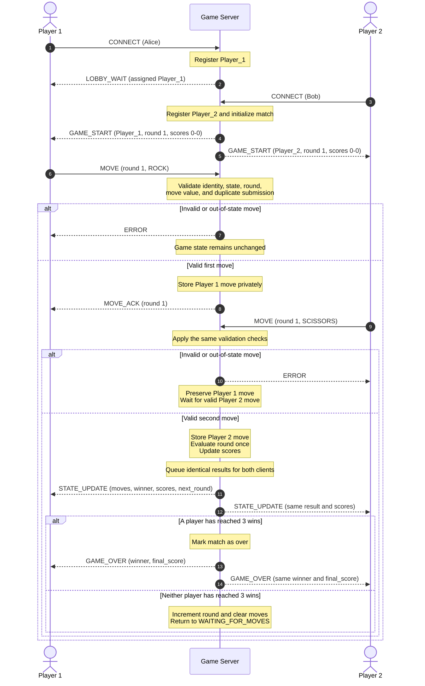

#Rock-Paper-Concurrency-Design

**Course:** CS 457 - Computer Netwsorks and the Internet
**Student:** Joanna Welch
**Game:** Rock-Paper-Scissors Duel
**Sprint:** Sprint 2 - Concurrency Design and Event loop strategy 

---
## 1. Concurrency Architecture 

### 1.1 Chosen Concurrency Model

The server will use nonblocking I/O multiplexing through Python's `selectors` module. One server thread will monitor the listening
socket and both client sockets using `selectors.DefaultSelector()`.

This model allows both players to remain connected and submit
messages without the server becoming stuck waiting for one player.
The server processes short operations for sockets that are ready,
then returns to monitoring all connections.

Rock-Paper-Scissors requires little computation to validate moves,
evaluate rounds, and update scores. A single event loop is sufficient
and avoids the additional coordination required by worker threads
and locks.

### 1.1 Connection Lifecycle

The server creates a TCP listening socket and binds it to
`0.0.0.0` on the port provided through the command line.

The listening socket is set to nonblocking mode using
`setblocking(False)` and registered with the selector for read events.

When the listening socket is readable, the server accepts an
available connection. The accepted client socket is also set to
nonblocking mode and registered for read events.

Each connection has its own record containing:

- The client socket
- The assigned player ID and alias after a valid CONNECT
- An incoming byte buffer
- An outgoing message queue
- The connection status

A TCP connection alone does not join a player to the game. The client
must first send a valid CONNECT message.

The first player receives Player_1 and LOBBY_WAIT. When the second
player joins, the server assigns Player_2, initializes the match,
and queues GAME_START for both clients.

The game supports two registered players. Additional clients receive
ERROR and are closed without changing the active match.

### 1.2 Event Loop Operation

The server repeatedly calls `selector.select()` to wait for activity
on its registered sockets.

When events become available, the server handles them one at a time:

1. Accept an available connection.
2. Read available bytes from a readable client socket.
3. Process complete messages in that client's incoming buffer.
4. Send queued bytes through a writable client socket.
5. Check connection and cleanup deadlines.

Waiting in `select()` allows activity on any registered socket to
wake the server. The server does not wait inside one client's handler
for that player to submit a move.

Each handler performs a limited amount of work before returning to
the event loop. If complete messages remain buffered after this limit,
the server schedules them for processing on a later loop iteration
without waiting for more network data.

This prevents one client from monopolizing the server while ensuring
buffered messages are eventually processed.

### 1.3 Incoming Message Buffers

TCP is a continuous byte stream. One `recv()` call may return part
of a message, one complete message, or multiple messages.

The server appends received bytes to that client's incoming buffer.
It extracts complete newline-delimited messages, decodes them as
UTF-8, and parses their JSON.

Incomplete messages remain buffered until more data arrives. The
server returns to the event loop rather than waiting for the rest
of a message.

Each incoming buffer has a size limit to prevent unlimited memory
use from oversized or unterminated messages.

### 1.4 Outgoing Message Queues

The server serializes outgoing messages as UTF-8 JSON followed by
a newline and places them in each destination client's outgoing queue.

Write-event monitoring is enabled only when a client has pending
output. When the socket is writable, the server attempts to send
queued bytes.

A send may transmit only part of a message. Unsent bytes remain
queued for a later write event.

If a nonblocking operation raises BlockingIOError, the server
preserves its buffers and returns to the event loop.

This prevents a slow client from blocking service to the other
player. Outgoing queues have size limits, and clients that cannot
drain their queues are handled through the disconnect policy.

### 1.5 EOF, Socket Errors, and Teardown

If `recv()` returns `b""`, the peer has closed its sending side of
the TCP connection. The server treats this EOF as a disconnect.

ConnectionResetError, BrokenPipeError, and other fatal
connection-related OSError exceptions also trigger disconnect
handling for the affected client.

BlockingIOError does not indicate a disconnect. It means the
operation must be retried when the socket is ready.

Before match initialization, a disconnect frees the lobby slot
without a forfeit. During an active match, it records a forfeit and
queues GAME_OVER for the remaining reachable player.

Disconnected sockets are unregistered from the selector, closed,
and removed from the connection records.

Reachable clients are given a bounded time to receive queued final
messages before their sockets are closed. A connection failure
affecting one client does not crash the server.

Further details are documented in the Socket Lifecycle and
Connection Error Handling section of protocol_blueprint.md.

## 2. Event Loop Isolation Strategy

### 2.1 Single Ownership of Game State

Only the server event loop may modify game state and connection
records. No worker threads or background callbacks modify these
structures.

The server maintains the following resources:

| Resource | Purpose |
|---|---|
| Player registry | Maps client connections to assigned player IDs and aliases |
| FSM state | Determines which actions are currently permitted |
| Current round | Identifies the round accepting moves |
| Stored moves | Holds each player's hidden choice |
| Scores | Tracks round wins for both players |
| Match result | Records whether the match ended and who won |
| Incoming buffers | Stores received bytes until complete messages are available |
| Outgoing queues | Preserves messages and their order for each client |

Because only one thread changes these resources, two handlers cannot
modify them at the same time. No threading.Lock is required.

The server must still validate messages. Single-threaded execution
does not make duplicate, wrong-round, or out-of-state moves valid.

### 2.2 Move Validation and State Mutation

Each MOVE is handled as one uninterrupted game-state operation.

The server:

1. Confirms the FSM is in WAITING_FOR_MOVES.
2. Checks that player_id matches the sending connection.
3. Validates required fields and their data types.
4. Checks that the move is ROCK, PAPER, or SCISSORS.
5. Checks that the round matches the current round.
6. Confirms the player has not already submitted a move.
7. Stores the accepted move.
8. Checks whether both players' moves are present.

If only one move is present, the server queues MOVE_ACK for that
player and continues waiting for the opponent.

If both moves are present, the server evaluates the round, updates
scores, and queues the result for both clients before processing
another message.

An invalid message produces ERROR for the submitting client.
Stored moves, scores, and the current round remain unchanged.

### 2.3 Simultaneous Move Submissions

Both players may submit moves at approximately the same time.
The selector may report both sockets as readable, but the server
processes their messages one at a time.

The first valid move is stored privately. The second valid move
completes the pair and triggers round evaluation.

Either player may be processed first. The processing order does
not affect the winner because the result depends on their choices.

Neither move is revealed until both valid moves have been accepted.

Checking the stored moves, evaluating the round, updating scores,
and preparing the next state all finish before another message
is handled. Therefore, the same round cannot be evaluated twice.

### 2.4 Round and Turn Enforcement

Rock-Paper-Scissors uses simultaneous choices rather than alternating
turns. Either player may submit first, but each player may submit
only one valid move per round.

A duplicate submission, wrong-round move, or MOVE received outside
WAITING_FOR_MOVES is rejected with ERROR.

After a continuing round, the server increments the round number
and clears both stored moves before accepting moves for the new round.

Scores are preserved between rounds.

### 2.5 Score and Leaderboard Synchronization

Scores are stored in server memory as a mapping from player IDs
to their number of round wins.

Both scores begin at zero. Winning a round awards one point.
A draw awards no points and still advances the round number.

After evaluation, the server creates one result snapshot containing:

- The completed round number
- Both players' moves
- The round winner or DRAW
- Both updated scores
- The next round number, or null if the match ended

The same STATE_UPDATE is queued for both clients before the server
handles another game action.

Each client displays the server-provided score table as its
leaderboard. Clients do not independently award points or decide
the authoritative match result.

Outgoing queues preserve message order. Both clients receive the
same round result and scores, although network delivery times may
differ. The server cannot guarantee delivery to a failed connection.

### 2.6 Match Completion and Disconnect Isolation

When a player reaches three wins, the server marks the match as
over and queues GAME_OVER after the final STATE_UPDATE.

If a disconnect is detected during an active match, the server
records a forfeit and declares the opponent the winner. Existing
round scores are preserved.

Before match initialization, a disconnect removes the player from
the lobby without recording a forfeit.

Disconnect handling runs through the same event loop as move
handling. Once the match is over, later events cannot change the
winner or award additional points.

Cleanup is performed only once per connection. Events referring
to a connection already removed by an earlier handler are ignored.

## 3. Move Validation and Score Broadcast Sequence

Either player may submit first. This example shows Player_1
submitting first, followed by Player_2.

The server validates each submission before changing game state.
Both players' choices remain hidden until both valid moves arrive.

The score table is maintained by the server and included in each
STATE_UPDATE. A round winner receives one point; a draw awards
no points.

For a continuing match, next_round identifies the next round.
For a match-ending round, next_round is null.

Broadcasts contain the same round result and scores for both
clients. Messages are queued during the same event handler and
delivered in order on each connection. Actual arrival times may
differ because of network delays.

For this round-based game, turn enforcement means accepting only
one valid move per player for the current round. Players do not
alternate turns.