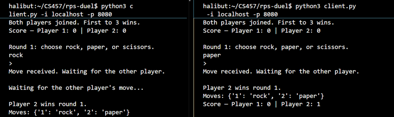
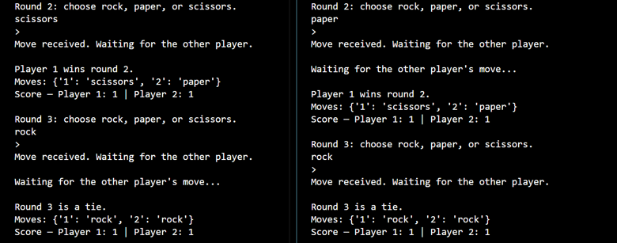
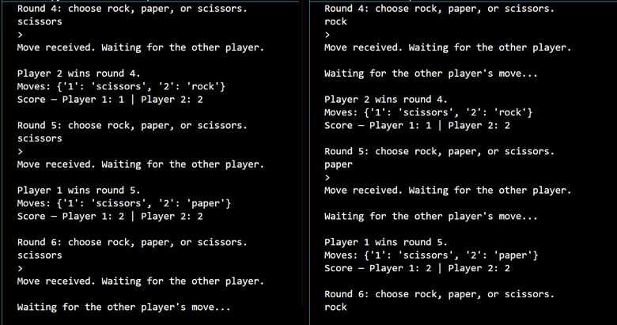
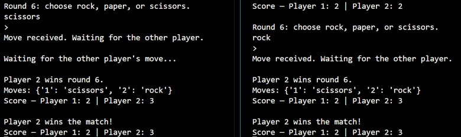

Student: Joanna Welch  
Course: CS457 Computer Networks and the Internet  
Assignment : Sprint 3 game log  
Date: 11/17/26  

# Rock Paper Scissors Duel

## The Lobby

Figure 1. Both clients connect to server on localhost:8080. Player 1 is waiting in the lobby until Player 2 joins. When player 2 joins, the server starts the match. First to three wins.

## Round 1

Figure 2. Round 1 Player 1 submits rock and Player 2 submits paper. At the end of the round, the server displays the moves chosen by each player and evaluates the round. This round is awarded to Player 2. The score is then updated. Player 1 :0 Player 2: 1.

## Round 3 tie behavior

Figure 3. Rounds 2 and 3 show more scoring and tie handling. Player 1 beats player 2 in Round 2 which ties the score. Round 3, both players choose rock which leaves the score unchanged at the end of Round 3.

## Rounds 4 and 5

Figure 4. Rounds 4 and 5 continue score tracking. Player 2 defeats Player 1 using rock vs scissors in Round 4. This makes the score 2-1 in favor of Player 2. Player 1 wins Round 5 playing scissors against paper. The match is once again tied at 2 -2 going in to Round 6.

## The Final Round – Game Over

Figure 5. Shows Round 6. Player 2 defeats Player 1 by submitting rock vs scissor. This brings Player 2 to 3 wins. The server announces Player 2’s victory and the final score.