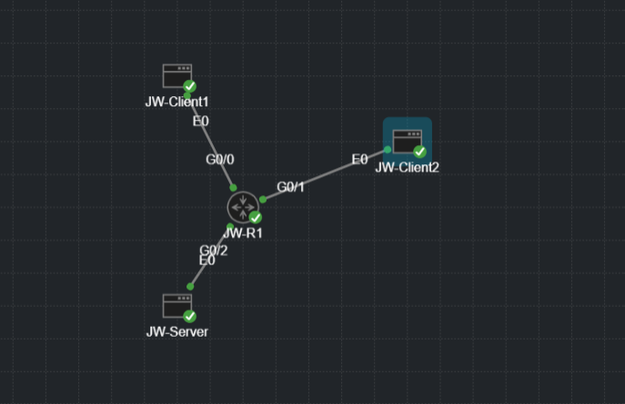
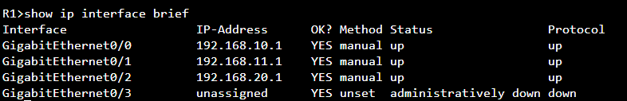
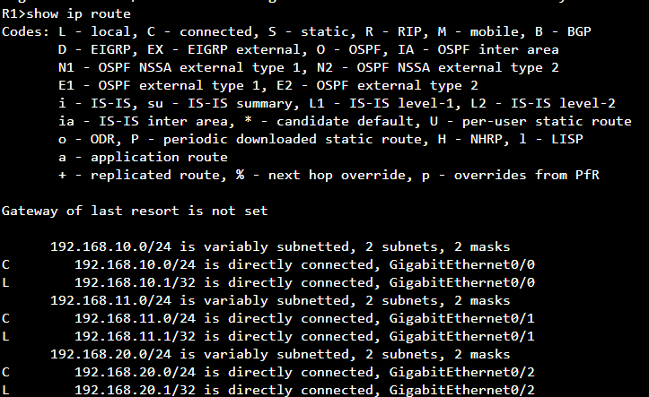
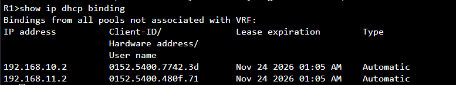
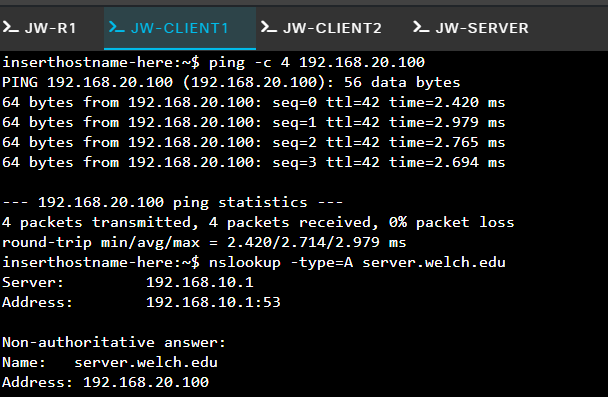
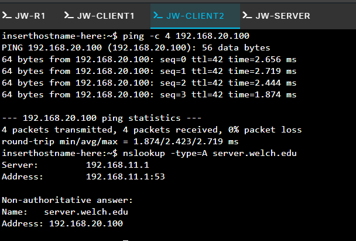
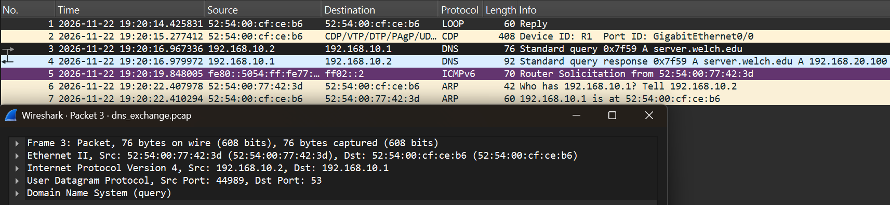
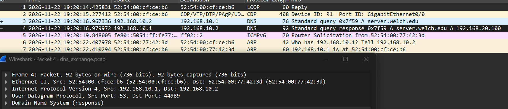

# Sprint 4 Network Verification Report

**Student:** Joanna Welch  
**Project:** Rock-Paper-Scissors Duel  
**DNS hostname:** `server.welch.edu`  
**CML topology:** One Cisco IOSv router connecting three subnets

## 1. Topology and addressing

The CML lab uses R1 to route between the two client networks and the game server network. The router interface numbers below match the interfaces shown in this lab.

| Node | Interface / role | Address |
|---|---|---|
| JW-Client1 | Client1 subnet, gateway R1 Gi0/0 | DHCP: 192.168.10.2/24 |
| JW-Client2 | Client2 subnet, gateway R1 Gi0/1 | DHCP: 192.168.11.2/24 |
| JW-Server | Server subnet, gateway R1 Gi0/2 | Static: 192.168.20.100/24 |
| JW-R1 | Gi0/0 | 192.168.10.1/24 |
| JW-R1 | Gi0/1 | 192.168.11.1/24 |
| JW-R1 | Gi0/2 | 192.168.20.1/24 |



## 2. Router verification

### Interface status

Command: `show ip interface brief`

```text
Interface                  IP-Address      OK? Method Status                Protocol
GigabitEthernet0/0         192.168.10.1    YES manual up                    up
GigabitEthernet0/1         192.168.11.1    YES manual up                    up
GigabitEthernet0/2         192.168.20.1    YES manual up                    up
GigabitEthernet0/3         unassigned      YES unset  administratively down down
```



### Routing table

Command: `show ip route`

R1 has connected routes for all three subnets. A default route is not required for this directly connected lab topology.

```text
Gateway of last resort is not set

C    192.168.10.0/24 is directly connected, GigabitEthernet0/0
L    192.168.10.1/32 is directly connected, GigabitEthernet0/0
C    192.168.11.0/24 is directly connected, GigabitEthernet0/1
L    192.168.11.1/32 is directly connected, GigabitEthernet0/1
C    192.168.20.0/24 is directly connected, GigabitEthernet0/2
L    192.168.20.1/32 is directly connected, GigabitEthernet0/2
```



### DHCP leases

Command: `show ip dhcp binding`

```text
IP address       Client-ID / Hardware address    Lease expiration          Type
192.168.10.2     0152.5400.7742.3d               Nov 24 2026 01:05 AM      Automatic
192.168.11.2     0152.5400.480f.71               Nov 24 2026 01:05 AM      Automatic
```



## 3. Client connectivity and DNS verification

Both client nodes successfully reached the game server at `192.168.20.100` with zero packet loss. The DNS lookup returned `192.168.20.100` for `server.welch.edu`.

### Client1

Client1 received `192.168.10.2/24`, uses gateway and DNS server `192.168.10.1`, and successfully pinged the server with 0% packet loss. The A-record lookup returned `192.168.20.100`.



### Client2

Client2 received `192.168.11.2/24`, uses gateway and DNS server `192.168.11.1`, and successfully pinged the server with 0% packet loss. The A-record lookup returned `192.168.20.100`.



## 4. Wireshark DNS exchange

The capture was taken on the JW-Client1–JW-R1 link. It shows the DNS query and matching response:

- **Packet 3 — DNS Standard Query:** Client1 (`192.168.10.2`) sent an A-record query for `server.welch.edu` to R1 (`192.168.10.1`) over UDP destination port 53. Transaction ID: `0x7f59`.
- **Packet 4 — DNS Standard Response:** R1 (`192.168.10.1`) replied to Client1 (`192.168.10.2`) over UDP source port 53 with the answer `server.welch.edu → 192.168.20.100`. Transaction ID: `0x7f59`.





